<a href="https://portafolio-jonatan.vercel.app/">
  <picture>
    <source media="(prefers-color-scheme: dark)" srcset="./assets/header-dark.svg">
    
  </picture>
</a>

  <a href="https://portafolio-jonatan.vercel.app/"><picture><source media="(prefers-color-scheme: dark)" srcset="./assets/buttons/btn-portafolio-dark.svg"></picture></a>
  <a href="https://www.linkedin.com/in/jonatan-sarmiento-16a206366/"><picture><source media="(prefers-color-scheme: dark)" srcset="./assets/buttons/btn-linkedin-dark.svg"></picture></a>
  <a href="https://mail.google.com/mail/?view=cm&amp;fs=1&amp;to=jonatandavidsarmientosierra@gmail.com&amp;su=Contacto%20desde%20GitHub"><picture><source media="(prefers-color-scheme: dark)" srcset="./assets/buttons/btn-correo-dark.svg"></picture></a>
  <a href="https://github.com/Jonatan-17?tab=repositories"><picture><source media="(prefers-color-scheme: dark)" srcset="./assets/buttons/btn-repositorios-dark.svg"></picture></a>
  <!-- Hoja de vida y carta de presentación: se activan cuando estén listos los PDF en docs/
  <a href="./docs/Hoja-de-vida-Jonatan-Sarmiento.pdf"><picture><source media="(prefers-color-scheme: dark)" srcset="./assets/buttons/btn-hoja-de-vida-dark.svg"></picture></a>
  <a href="./docs/Carta-de-presentacion-Jonatan-Sarmiento.pdf"><picture><source media="(prefers-color-scheme: dark)" srcset="./assets/buttons/btn-carta-dark.svg"></picture></a>
  -->

## Sobre mí

Soy **Jonatan David Sarmiento Sierra**, desarrollador de software formado en **Campuslands**. Me enfoco en el **backend con Java y Spring Boot**: APIs REST con seguridad JWT, bases de datos relacionales bien modeladas y pruebas automatizadas. También conecto aplicaciones con **automatizaciones en n8n e inteligencia artificial**, como búsqueda semántica (RAG), visión por computador y bots de Telegram.

Aprendo rápido, trabajo en equipo con Git y ramas por integrante, y busco mi primera oportunidad como desarrollador backend.

<picture>
  <source media="(prefers-color-scheme: dark)" srcset="./assets/value-dark.svg">
  
</picture>

## Proyectos destacados

  <a href="https://github.com/Jonatan-17/campusdesk"><picture><source media="(prefers-color-scheme: dark)" srcset="./assets/projects/campusdesk-dark.svg"></picture></a>
  <a href="https://github.com/Jonatan-17/recetas-rag"><picture><source media="(prefers-color-scheme: dark)" srcset="./assets/projects/recetas-rag-dark.svg"></picture></a>
  <a href="https://github.com/Jonatan-17/smartcity-f"><picture><source media="(prefers-color-scheme: dark)" srcset="./assets/projects/smartcity-f-dark.svg"></picture></a>
  <a href="https://github.com/Jonatan-17/SafeGuardian"><picture><source media="(prefers-color-scheme: dark)" srcset="./assets/projects/safeguardian-dark.svg"></picture></a>
  <a href="https://github.com/Jonatan-17/gamer-jpa"><picture><source media="(prefers-color-scheme: dark)" srcset="./assets/projects/gamer-jpa-dark.svg"></picture></a>
  <a href="https://github.com/Jonatan-17/coworking-db"><picture><source media="(prefers-color-scheme: dark)" srcset="./assets/projects/coworking-db-dark.svg"></picture></a>

**Más proyectos:** [Don't Give Up](https://github.com/Jonatan-17/Don-t-give-up) (finanzas personales con gamificación) · [Mega Music App](https://github.com/Jonatan-17/mega-music-app) (interfaz de streaming y tienda) · [Sistema de Aeropuerto](https://github.com/Jonatan-17/SistemaAeropuerto) (POO en Java) · [Gestor de Gastos](https://github.com/Jonatan-17/gestor-gastos-python) (Python)

## Stack

<picture>
  <source media="(prefers-color-scheme: dark)" srcset="./assets/stack-dark.svg">
  
</picture>

<strong>Ver el stack en texto</strong>

| Área | Tecnologías |
| :--- | :--- |
| Backend | Java 21 · Spring Boot · Spring Security (JWT) · JPA / Hibernate · Python · FastAPI |
| Datos | PostgreSQL · MySQL · H2 |
| IA y automatización | n8n · Google Gemini · OpenRouter · Qdrant · MediaPipe |
| Frontend | HTML · CSS · JavaScript |
| Herramientas | Git · Docker · Gradle · Maven · Swagger · IntelliJ IDEA |

## Mi camino

<picture>
  <source media="(prefers-color-scheme: dark)" srcset="./assets/timeline-dark.svg">
  
</picture>

## GitHub en números

<a href="https://github.com/Jonatan-17?tab=repositories">
  <picture>
    <source media="(prefers-color-scheme: dark)" srcset="https://github.com/Jonatan-17/Jonatan-17/raw/stats/github-dark.svg">
    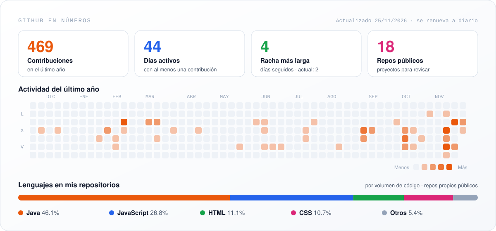
  </picture>
</a>

El panel se genera todos los días con GitHub Actions a partir de datos públicos ([`scripts/update_stats.py`](scripts/update_stats.py)).

## Contacto

<a href="https://mail.google.com/mail/?view=cm&amp;fs=1&amp;to=jonatandavidsarmientosierra@gmail.com&amp;su=Contacto%20desde%20GitHub">
  <picture>
    <source media="(prefers-color-scheme: dark)" srcset="./assets/contact-dark.svg">
    
  </picture>
</a>

  <strong>jonatandavidsarmientosierra@gmail.com</strong> 
  Escríbeme desde <a href="https://mail.google.com/mail/?view=cm&amp;fs=1&amp;to=jonatandavidsarmientosierra@gmail.com&amp;su=Contacto%20desde%20GitHub">Gmail</a> &nbsp;·&nbsp; <a href="https://outlook.office.com/mail/deeplink/compose?to=jonatandavidsarmientosierra@gmail.com&amp;subject=Contacto%20desde%20GitHub">Outlook</a> &nbsp;·&nbsp; <a href="mailto:jonatandavidsarmientosierra@gmail.com">tu app de correo</a> 
  <a href="https://www.linkedin.com/in/jonatan-sarmiento-16a206366/">LinkedIn</a> &nbsp;·&nbsp; <a href="https://portafolio-jonatan.vercel.app/">Portafolio</a>

Piedecuesta, Santander · Colombia — Backend con Java, automatización con IA.

